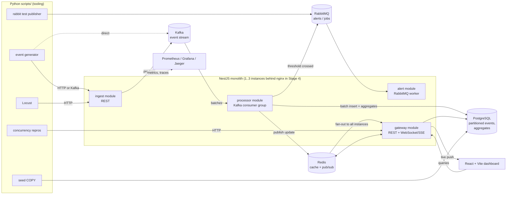
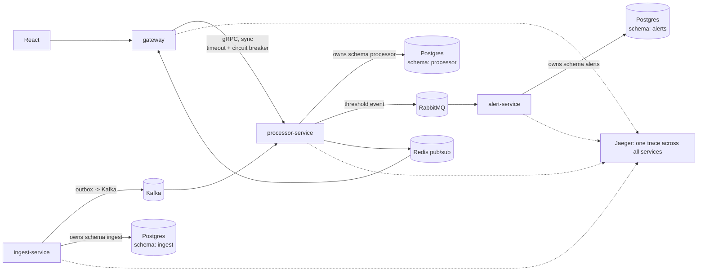

# Live Pulse

A real-time event dashboard built as a **learning project**. Events stream in, get stored and aggregated, and are pushed live to a heavy React dashboard.
The point is not the product. The point is to hit real backend/fullstack problems hands-on and be able to explain them afterwards:
transactions and isolation levels, concurrent updates, DI scopes, memory leaks, Kafka vs RabbitMQ, delivery guarantees, scaling, diagnosing slow things, monolith vs microservices, REST vs GraphQL vs RPC.

Work is run like a small company: Claude plays the **client** (tickets as GitHub Issues, demo reviews) and the **tech lead** (honest reviews), and writes the **handbook** in `docs/`. I write the code. See [CLAUDE.md](CLAUDE.md).

## Architecture

### Stages 1-4: modular monolith

One NestJS process with clean module boundaries (these become services in Stage 5).



### Stage 5: microservices



| Piece | Role |
|-------|------|
| Kafka | Main event stream; consumer group writes batches to Postgres; replayable log |
| RabbitMQ | Alerts and background jobs: exchanges, ack/nack, retry, dead-letter queue |
| Redis | Cache + pub/sub so WebSocket fan-out works across instances |
| Postgres | Time-partitioned events, aggregates, materialized views; one schema per service in Stage 5 |
| Python | Tooling only: generator, seeding, concurrency repros, load tests, charts |

## Run it from scratch

Prerequisites: Docker (with Compose v2), `uv` (for Python), Node.js LTS (from Stage 1), `gh` CLI.

```bash
cp .env.example .env
docker compose up -d                                       # core infra
docker compose --profile rabbit --profile tracing up -d   # + RabbitMQ and Jaeger when needed
docker compose ps                                          # wait until everything is "healthy"
```

| UI | URL |
|----|-----|
| Grafana | http://localhost:3001 (admin / admin) |
| Prometheus | http://localhost:9090 |
| RabbitMQ management | http://localhost:15672 (livepulse / livepulse) |
| Jaeger | http://localhost:16686 |

Python tooling: `cd scripts && uv sync` (see [scripts/README.md](scripts/README.md)).
The NestJS and React apps arrive in Stage 1; a single run command for them will be added here at that point.

## Docs

| Doc | What |
|-----|------|
| [docs/ROADMAP.md](docs/ROADMAP.md) | Stages and definitions of done |
| [docs/TOPICS_MAP.md](docs/TOPICS_MAP.md) | Interview question -> what I do -> where it lives |
| [docs/EXPERIMENTS.md](docs/EXPERIMENTS.md) | Break-and-fix experiments |
| [docs/topics/](docs/topics/) | Handbook chapters (databases, Node runtime, NestJS, messaging, microservices, API styles, TS/React patterns, scaling and diagnostics) |
| [docs/STUDY_NOTES.md](docs/STUDY_NOTES.md) | Stories from real project history |
| [docs/DECISIONS.md](docs/DECISIONS.md) | Decision log with review feedback |
| [docs/PYTHON_NOTES.md](docs/PYTHON_NOTES.md) | Python cheat sheet |
| [docs/HANDBOOK_GUIDE.md](docs/HANDBOOK_GUIDE.md) | How the handbook is written |
| [docs/roles/](docs/roles/) | Client and tech lead role definitions |
